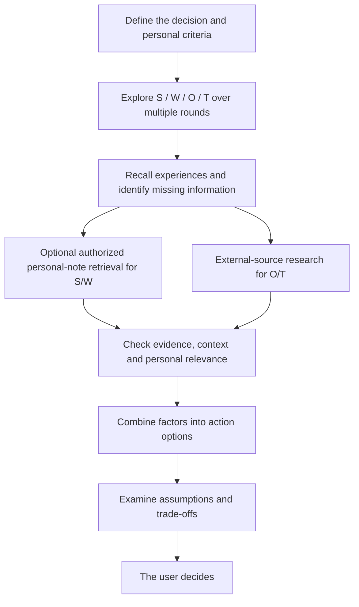

# mySWOT

**A question-led decision companion that connects your experiences, permissioned personal notes, and current external evidence.**

[中文说明](README.zh-CN.md) · [Illustrative example](examples/career-decision.md) · [Evaluation protocol](evals/README.md)

mySWOT helps you investigate a career, study, personal, or project decision before settling on a short list of options. It asks follow-up questions, checks assumptions, and shows trade-offs. You make the decision.

## What it does

- Explores Strengths, Weaknesses, Opportunities, and Threats separately, usually for 2–3 rounds each, with 2–3 related questions per round.
- Checks imminent commitment deadlines and potentially disqualifying budget or eligibility constraints before prolonged exploration of a specific option.
- Starts with your own recollection. With explicit permission, it can use available personal knowledge sources to surface forgotten experiences and possible S/W clues.
- Searches external sources after your first O/T responses, distinguishes source facts from AI interpretation, and checks whether the findings apply to you.
- Connects confirmed factors into SO/WO/ST/WT action options, then examines costs, assumptions, reversibility, and trade-offs without ranking your life choices.

Private records are clues, not a verdict about your personality. Missing records do not mean missing ability. Personal-data retrieval is optional and requires an available connector or user-provided files.

## Try it

Clone or download [Hanaaa-Sying/mySWOT](https://github.com/Hanaaa-Sying/mySWOT):

```sh
git clone https://github.com/Hanaaa-Sying/mySWOT.git
```

The current package is under [`skills/myswot`](skills/myswot/SKILL.md). Place the complete folder in your agent's supported skill directory; keep its `references` and `agents` folders together with `SKILL.md`. Do not overwrite an existing installation without reviewing the differences.

For a project-scoped Codex installation, copy `skills/myswot` into `<your-project>/.agents/skills/myswot`. Discovery of this public package from that location was verified locally. Start with:

```text
Use $myswot to help me think through whether to pursue further study or start working.
Ask follow-up questions before forming options. Ask before reading any personal notes.
```

The skill instructions and default interaction language are Chinese. You can request another response language; English interaction behavior has not yet been evaluated.

## The interaction



The default is a deep conversation: normally 8–12 substantive exploration rounds across the four dimensions, plus framing and synthesis. This is not a time estimate. You can skip a topic or ask for an early summary; incomplete coverage remains visible.

## Privacy and evidence

- Connecting a service is not permission to inspect it. The assistant asks about source, topic/file scope, dates, and exclusions before private retrieval.
- Within the agreed scope, it can continue without asking permission for each search; broader access requires a new agreement.
- Private access is read-only by default. The skill does not ask for permanent profiles, background monitoring, or automatic writeback.
- Personal-note text is not sent to public web searches. Public queries should use generic, non-identifying terms.
- Source instructions are treated as data, not new authorization.

These are instructions for the host agent, not an independently enforced security boundary. The host's permissions, connector behavior, retention policies, and model behavior still apply.

## Compatibility and evidence status

| Item | Status |
|---|---|
| Local Codex skill discovery | Original user installation verified on 2026-11-17; public `myswot` package verified as enabled at project scope on 2026-11-18, with no skill-load errors |
| YAML and local reference integrity | Checked |
| Scenario review | Manual review using fictional situations |
| Comparative behavioral evaluations | One synthetic graduation-decision case, one full run per condition, plus targeted regression checks; see the report below |
| Real-user outcomes | Not yet measured |
| Other agents and knowledge connectors | Not tested end to end |

The brand and display name are **mySWOT**. The technical identifier and installable folder are **`myswot`**, following the lowercase-name requirement in the [Agent Skills specification](https://agentskills.io/specification). The public package passes the skill structure validator. Do not install it alongside the original mixed-case package on case-insensitive filesystems; compare and choose one version.

### First evaluation: useful detail, substantial cost

In the first synthetic comparison, the original skill used **13 assistant turns / 4,325 non-whitespace characters**, versus **7 turns / 2,315 characters** without a skill. Both handled the main cost, scholarship, deadline, and note-attribution traps correctly. The skill surfaced additional application-timing and exploration-funding questions, but reached the full funding gap later. This is not evidence of overall superiority.

The revision moves concrete deadlines and feasibility checks earlier while preserving deep quadrant exploration. A fresh three-turn checkpoint run reached the full estimated funding gap in turn 3, versus turn 10 in the original run. This partial rerun does **not** establish shorter full interviews or better real-world decisions. It also exposed uncertainty-wording issues, which were addressed in a narrow follow-up. [Full report, transcripts, fictional fixtures, and version snapshots](evals/results/2026-11-18-graduation/report.zh-CN.md).

## Background

The approach combines SWOT/TOWS teaching materials with ideas from Felipe A. Csaszar's *AI Is Revolutionizing Strategic Decision-Making* (Harvard Business Review, September–October 2026). The application to personal decisions and permissioned notes is this project's design extension, not a validated result claimed by that article.

See [foundations](skills/myswot/references/foundations.md) for source locations and boundaries. Source PDFs, private notes, credentials, and the creator's personal file paths are not part of this package.

## Feedback

Useful reports describe the decision type, host/model, what the assistant did, and what should have happened. Share minimal fictional or independently sanitized examples; do not post private notes or other people's personal information. Please distinguish expected behavior from an actual observed run.

## License

[MIT](LICENSE), for this repository's original skill instructions and documentation. The cited course materials and article retain their own rights and are not redistributed here. See [third-party notices](THIRD_PARTY_NOTICES.md).
